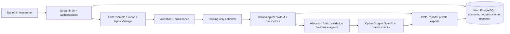

# ◈ QuantMesh — Portfolio Optimizer with Multi-Agent Research

**Build a portfolio, test it on unseen historical data, understand its risks, and export reproducible research.**

[**Live Streamlit demo**](https://quantmesh-portfolio-optimizer-using-multi-agent-rag-7ujd3x7e8m.streamlit.app/) · [Architecture](docs/architecture.md) · [Guided demo](docs/demo-guide.md) · [Validation](docs/production-readiness-audit.md) · [Security](docs/security.md)

> **Demo access:** The public URL opens a **sign-in-gated** research workspace. Accounts are provisioned privately by the operator; there are no public default credentials or public sign-up. The app does not place trades or offer investment advice.

## What it does

| Capability | Implementation |
|---|---|
| **Portfolio optimization** | Constrained **minimum variance** and **maximum Sharpe** allocation; long-only, fully invested weights with configurable caps |
| **Out-of-sample evaluation** | Chronological training/holdout split, buy-and-hold comparison against equal weight, initial trading costs |
| **Risk dashboard** | Total return, CAGR, volatility, Sharpe ratio, max drawdown, daily historical VaR, correlation heatmap and drawdown curves |
| **Four price sources** | Reproducible synthetic samples, validated CSV uploads, Yahoo Finance adjusted daily history, Alpha Vantage adjusted history (premium entitlement) |
| **Multi-agent review** | Deterministic allocation, risk, validation and evidence-synthesis agents with cited local methodology |
| **Optional AI explanations** | Consent-gated OpenAI/Groq generation, allowlisted source IDs and exact-quote validation; AI interpretations remain explicitly unverified |
| **Research exports** | CSV prices/weights, structured JSON reports and owner-scoped saved research |
| **Protected access** | Provisioned multi-user accounts, scrypt password hashes, revocable one-hour sessions, request limits and Neon PostgreSQL storage |

### Live demo walkthrough

1. Sign in using an **operator-provisioned** account. (The login gate is intentional.)
2. Select **Sample market** to evaluate the same reproducible, explicitly synthetic data without using provider keys.
3. Compare **Minimum variance** and **Maximum Sharpe**; inspect performance, target weights, correlations and drawdowns.
4. Under **Research agents**, examine methodology citations. The optional AI button sends only a consented question, summary metrics and selected methodology to the configured provider.
5. Under **Data & export**, download CSV/JSON results; under **Saved research**, save and reopen a snapshot within your own account.
6. For external data, choose **Yahoo Finance** or upload a CSV. Alpha Vantage's adjusted daily endpoint requires compatible premium access and is **not** silently replaced with unadjusted closes.

See the [guided demo and screenshot/privacy notes](docs/demo-guide.md) for exact controls and expected states.

## Architecture



**Stack:** Python 3.11/3.12 · pandas · NumPy · SciPy (SLSQP) · Plotly · Streamlit · psycopg/PostgreSQL · SQLite for local mode · optional Groq/OpenAI · yfinance · pytest/Ruff/GitHub Actions.

The optimizer uses training observations to estimate returns and covariance; holdout observations are used to **evaluate**, not fit, the selected weights. Portfolio weights are long-only, capped and sum to one. Annualization uses 252 trading observations, and the benchmark is an equal-weight buy-and-hold portfolio with comparable initial costs. Maximum-Sharpe optimization is a numerical local solution, not a promise of higher future returns.

## Quick start (private local demo)

```bash
python -m venv .venv
# Linux/macOS:
source .venv/bin/activate
# Windows PowerShell: .\.venv\Scripts\Activate.ps1

python -m pip install -c constraints.txt -e '.[dev]'
streamlit run app.py --server.address=127.0.0.1
```

Private single-user mode with synthetic data works **without API keys**. Do not expose local single-user mode publicly. Valid CSV layout: `Date,Asset A,Asset B,...`, ascending unique dates, 2–30 assets, 61–10,000 daily rows, finite positive prices without missing values. Users must verify dividend/split adjustment and currency consistency before interpreting their own uploads.

For **public multi-user** deployment use `cloud_app.py`, `QUANTMESH_BACKEND=postgres`, private app-role database credentials and the [Neon + Community Cloud guide](docs/neon-community-cloud.md). Never upload a real `.env`, `.streamlit/secrets.toml`, account records, keys or database URL. The tested Cloud setup uses a **direct Neon endpoint**; pooling is optional only after separate reachability testing. Free tiers may sleep and do not guarantee uptime.

## Data sources and limitations

- **Yahoo Finance:** Historical adjusted prices via the unofficial `yfinance` adapter; no user API key. Source freshness and provenance are displayed. Provider availability and licensing terms apply.
- **Alpha Vantage:** `TIME_SERIES_DAILY_ADJUSTED` requires an entitled API plan. Free keys may be rejected. The UI explains the limitation and points to Yahoo; it **never relabels unadjusted closing prices as adjusted**.
- **Sample market:** Synthetic, reproducible and prominently labeled. It is not market history, even when a provider fallback substitutes sample data.
- **CSV upload:** Validated historical prices provided by the user; the app cannot independently certify corporate-action adjustment.
- **AI research:** The source corpus contains local methodological passages, **not live financial news**. Exact citation/quote validation does not prove that the model's interpretation is true.

There is no execution engine, tax model, liquidity model, guaranteed maximum-Sharpe optimum, managed off-site backup, public account registration or formal security certification.

## Testing and release evidence

```bash
pytest -q
ruff check .
python -m pip check
```

[CI](https://github.com/umang-kumar03/QuantMesh-Portfolio-Optimizer-using-Multi-Agent-RAG/actions) runs Python 3.11/3.12 with a disposable PostgreSQL 17 database, plus a pinned-dependency audit. An earlier full production-readiness review recorded **236 passing tests**; later Alpha Vantage guidance added regression tests. Check the latest green workflow for current results. Some provider tests use **mocked** HTTP responses rather than paid or production credentials.

**Manually checked on October 27, 2026** (owner-led browser walkthrough): authenticated sign-in/out, minimum-variance and maximum-Sharpe UI, risk charts, consented Groq explanation, CSV/JSON downloads, saved research across refresh/re-login, CSV upload and **non-synthetic Yahoo Finance** history. This is a functional smoke test—not an uptime, performance or penetration-test guarantee. Alpha Vantage premium adjusted-price access remained unavailable; its error handling was checked.

For evidence boundaries and operator checks see [production-readiness audit](docs/production-readiness-audit.md) and [public-demo security checklist](docs/public-demo-security-checklist.md).

## Documentation

[Architecture](docs/architecture.md) · [Research and attribution](docs/research.md) ·
[Data sources](docs/data-sources.md) · [Deployment](docs/deployment.md) ·
[Neon Community Cloud setup](docs/neon-community-cloud.md) ·
[Security](docs/security.md) · [Roadmap](docs/roadmap.md)

**Disclaimer:** Research and educational software only. Historical backtests, optimized allocations and AI explanations are not investment advice or predictions.
