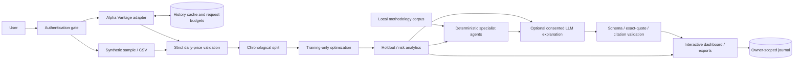

# Architecture

QuantMesh extends the original portfolio research application without replacing
its analytics engine. Python 3.11/3.12, Streamlit, Plotly, pandas/NumPy, SciPy and
SQLite keep the entire research workflow testable without a separate SPA/API tier.
One private instance supports local single-user operation or provisioned small-group
accounts. Public trading, enterprise identity and horizontal scaling are out of scope.

## Modules and interfaces

- `data.py`: strict CSV boundary and seeded synthetic data.
- `analytics.py`: existing constrained optimization, holdout and metrics functions.
- `market.py`: Alpha Vantage adjusted history, persistent cache and atomic budgets.
- `http.py`: bounded HTTPS transport, fixed timeouts, disabled redirects, safe errors.
- `agents.py`: allocation/risk/validation reports and local lexical retrieval.
- `llm.py`: fixed OpenAI/Groq endpoints, structured generation and citation validation.
- `auth.py`: scrypt verification, signed expiring sessions and the UI access gate.
- `manage_users.py`: operator provisioning, secure prompts and atomic credential-file writes.
- `storage.py`: transactional schema migration and owner-filtered SQLite journal.
- `reports.py`: strict JSON reports and spreadsheet-safe CSV exports.
- `app.py`: UI orchestration, explicit provider actions, consent, charts and reports.

Streamlit owns HTTP/WebSockets and server-side session state. Analytical functions
are the internal Python API; there is no separate public REST endpoint. UI settings
remain in the current session. The generated explanation has no tools or write path
into analytics, portfolio allocations or journal contents.

## Data and request flow

Alpha Vantage uses `TIME_SERIES_DAILY_ADJUSTED`, `outputsize=full` and the configured
key. Provider access/plan entitlement is required. Fixed endpoint and symbol validation
prevent arbitrary URL requests. Histories must contain matching symbol metadata
and finite positive adjusted prices. Intersect dates without forward filling;
then slice the requested range and apply the existing dataset validator.

`market_cache(symbol, fetched, payload)` and
`request_budget(service, requested)` live in QUANTMESH_CACHE_DB. Cache freshness
is six hours; failed refreshes may reuse data for at most seven days. Freshness
and last-observation timestamps are separate provenance fields. Refresh replaces
full adjustment history to incorporate revised corporate actions. Cache is bounded
to 64 symbols and shared only for licensed provider data. Uploaded datasets never
enter it. If enabled, whole-portfolio sample substitution is labeled in the UI and
report; no synthetic and real series are mixed. No provider fetch occurs merely
because an optimization setting changes.

Atomic SQLite reservations enforce rolling minute/day budgets across sessions and
restarts: market 5/25, LLM 3/50, global login 30/1000 and per-username login 5/100.
Failures count. Calls use connect/read timeouts, a 5 MB decompressed response limit,
no redirects and no general automatic retry loops. LLM requests have a 60-second read
timeout (market requests retain 20 seconds). Groq uses max_completion_tokens; only
a known HTTP 400 JSON-generation error gets one recovery request without JSON mode.
Both attempts count against the budget, and recovered output must pass all existing
citation/schema checks. No retry changes models or credentials.

## Quantitative model (preserved)

Daily simple returns from positive adjusted closes. Annualization assumes 252
observations/year. The chronological training segment estimates arithmetic means
and sample covariance; covariance is 90% sample plus 10% diagonal and a small ridge.
SLSQP solves long-only, fully invested weights subject to an asset cap. Maximum
Sharpe is a local numerical solution, not a promised global optimum.

Fit through the training close. Test returns begin after that close. Buy-and-hold
equity is the weighted sum of cumulative asset returns; weights drift naturally.
The optimized and equal-weight portfolios each pay the chosen initial notional
cost once. Initial pre-cost capital is included in equity and drawdown. Sharpe is
annual arithmetic excess return divided by sample annual volatility; zero-volatility
Sharpe is undefined. Historical daily VaR is the signed 5th-percentile return.
CAGR compounds test returns over n/252 years. No leverage, hidden rebalances,
taxes, liquidity model or execution infrastructure.

## Generated research boundary

Local methodology passages are retrieved using token overlap and inverse document
frequency. LLM sources consist only of those retrieved passages plus F1 (computed
holdout metrics) and F2 (split dates). These labels are internal evidence, not
fabricated external financial publications. No financial-news discovery is claimed.

Explicit consent sends the question, selected passages and computed summary facts.
No raw prices, ticker names or stored journal records are included automatically.
A model returns claim objects with an exact quote, known source ID and free-text
interpretation. The validator rejects unknown IDs, nonmatching excerpts, URLs,
malformed schemas and excessive output. The server creates source labels; generated
text is rendered as plain text and labeled unverified. This validates citation
identity/quotes, not semantic truth of every interpretation.

## Accounts and storage

Multi-user mode authenticates before creating research UI or reading records.
Provisioned account JSON resides outside the checkout with restricted permissions.
Passwords use salted scrypt. HMAC sessions have a one-hour lifetime and are bound
to the current password record. Removing an account, replacing a hash or rotating
the signing key revokes access on the next rerun. Sign-out clears session uploads,
market results and credentials. Single-user mode uses the reserved `local` owner.

The journal schema is `runs(id,created,name,payload,owner)`, indexed on `(owner,id)`.
Migration adds owner transactionally and leaves legacy records as `local`; named
accounts cannot use that reserved identity. Every named-user read/write supplies
the authenticated owner through parameterized SQL. Raw uploads are not persisted.
SQLite is appropriate for one instance and small private groups; a future multi-replica
service requires PostgreSQL, enterprise identity, migrations and stronger operations.

## Yahoo Finance adapter

`yahoo.py` adds a separate input adapter; existing analytics, auth, journal ownership
and Groq generation remain unchanged. `YahooClient` returns the same MarketResult
contract as Alpha Vantage. It selects explicit Adj Close from supported flat or
MultiIndex download shapes and records cleaning/provenance before existing validation.
No Close substitution or missing-price imputation is permitted. Yahoo's six-hour,
64-entry request cache uses a separate yahoo_history table and a yahoo-download
budget. Counts limit logical downloads, not yfinance's internal HTTP/cookie requests.
The sidebar stores results per provider to avoid source mislabeling. Reports retain
Yahoo provenance or explicit synthetic fallback metadata. Network access, revisions
and licensing limitations are detailed in data-sources.md.

## Production boundary

`serve.py` validates multi-user startup, mounted-directory configuration, protected
accounts and schemas before exec'ing Streamlit on the platform PORT. Render's native
Python service and persistent disk are the reference topology; Docker uses the same
launcher. `account_store.py` serializes operator updates and fsyncs atomic replacement.
Accounts are seeded once, then persist independently of app releases. `sqlite_utils.py`
sets WAL/full-sync/lock policy; journal schema version 1 rejects newer versions.
`backup.py` uses online SQLite snapshots and checksum/integrity-verified offline
restore into a new directory. Multi-user exports are browser-local via exports.py,
not public Streamlit media URLs. See production-deployment.md for topology limits.

## Free-hosting storage boundary

Production startup requires `QUANTMESH_STORAGE_MODE=persistent-local` in addition
to multi-user authentication and durable paths. This is an operator declaration,
not a persistence detector. Do not use it to bypass an ephemeral host limitation.
Both account membership/revocation and login/provider budgets must persist along
with owner-scoped research. No external SQL backend or partial migration is added.
See [free-hosting compatibility](free-hosting.md) for verified evidence, unverified
provider quotas, the private Compose demo path and remaining deployment gates.
